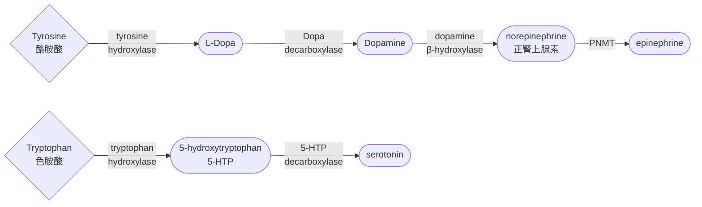

# 1st midterm of neurophysiology
## week 2
### 發現神經元
#### Nissl stain
- 利用**cresyl violet**，可以染色rough ER
- 然後在大腦切片染色後，發現裡面的細胞有顆粒狀藍色的東西
- **所謂的Nissl body，其實就是rough ER**
- 這些聚集rough ER的地方，其實就是neuron的cell body
- 但是**光用Nissl stain並無法觀察到細胞的全貌**

#### Golgi stain
- 基本上就是**銀染**，在畫面下呈現黑色
- Golgi本身是義大利精神科醫生，胞器的golgi body名字就是來自於這
- 在銀染的情況下，就可以看到幾乎neuron的全貌，包含fiber
- 他因此認為大腦的細胞很像聖誕樹的燈一樣串聯
- 並且提出**reticular theory**，認為**細胞們就是連在一起的**，又稱為**syncytium**

#### Cajal 的推翻
- 他透過再次複刻並延伸Golgi 的實驗，結果發現syncytium似乎有問題
- 因為他覺得，**細胞們只是互相靠很近，並沒有連在一起**
- 因此提出**neuron theory**，也就是 **"神經元的細胞是互相獨立的"**
- 後來Cajal又欸稱為 **"神經學之父"**

#### Golgi摸摸鼻子繼續實驗
- 後來Gogi只好再次調整自己的實驗，讓銀染不要染太深，發現細胞內有別的東西，不同於他以前看到的狀態
- 發表之後，多數人以為這是實驗汙染造成的

> [!Tip]
> - Crowd: 你特麼手抖吧，還是顯微鏡品質超遜? 🤣🤣
> - Golgi: 💀💀

- 但是**這其實就是後來大家所知的Golgi body**，被後人再現實驗發現

#### Cajal 和 Golgi是被科研耽誤的畫家? 🧐
- 以前的科學家發現自己看到的東西，只能用畫的，無法攝影
- 這些科學家各個都很會畫畫

> 以下是Golgi繪製的海馬體切片圖 😏

- Cajal這位神經學之父也非常會畫圖，因此在後世留下很多解剖後顯微鏡下的圖像

> [!Note]
> 甚至有人出書，專門蒐集Cajal的手繪圖鑑 🐱

### 讓我們回到正題呵呵
#### neuron組成
- 長得不規則，但是每個neuron都一定有**cell body (soma，或是perikaryon)**
- 神經纖維 (無論是**dendrite**還是**axon**)，統稱為**neurites**
- dendrite基本上會接收不同種神經元的信號，可能是抑制，可能是活化，可能同時出現
- 這時可能會根據信號權重，或是soma的處理方式，選擇性做respond，並且沿著axon傳遞
> [!Note]
> - 目前的SEM也可以呈現出這些neurites的狀態
> - 也可以模擬染色，甚至區分dendrite和axon !

- soma和普通細胞的內部構造可能差不多，一樣有必要得胞器、細胞核、核糖體啥的
- 其中，裡面的cytosol的 $K^+$ 濃度相較於其他一般細胞更高
- 細胞膜上面也有很多重要的膜蛋白

- 這些蛋白質，有些接收訊號 (如GPCR)，有些就是離子通道 (可能是主動運輸，或是單純的channel)
- pump需要ATP消耗，改變蛋白質結構，改變自身的對物質的親和力
- 最常見的例子就是鈉鉀幫浦

- pore基本上就是通道，如aquaporin之類的

### cytoskeleton
- 神經細胞也有細胞骨架，也有三種骨架
- 其中，所謂的**neurofilament**就是**intermediate filament**
- 微管是由tubulin聚合而成，他也可以拆解，當soma被刺激時，細胞級聯反應會促進微管的結構改變
- 這也是**神經可塑性**的原理之一
- neurofilament基本功能就是維持細胞張力，但是和神經可塑性的相關性可能不高

> [!Tip]
> - IF的排列方式不一樣，結構也會有所不同
> - keratin的結構不一樣，就會影響你的頭髮結構

- microfilament的功能一部份和微管類似，也會透過聚合和解聚，影響細胞結構

> 以下為AD患者的一個細胞內部的細胞骨架構造，可以發現中間絲的不正常聚集 (tangle)。其中，**Taupathy = Tau蛋白病變**，這些病變主要體現在大腦皮質。同時，在臨床上，AD的病理表徵之一就是情緒異常

#### 臨床和動物實驗的差別

- 不少藥物會呈現出 "動物實驗完美，臨床上很遜" 的狀態
- 可能的原因是因為: 
   - 人體有太多別的因素，會有相互作用，互相影響
   - 多數需要治療的AD患者已經出現嚴重的皮質損傷，因此藥物的輔助可能差強人意

#### 治療
- 目前已經少有侵入性治療，除非你是嚴重的癲癇或是腦瘤，部通常不畏隨便取腦組織
- 多數檢測病情的方式，可能會用fMRI掃描

> [!Tip]
> - 如果可以觀察哺乳類的基底核區域 (包含杏仁核、海馬體)，基本上... 長得真得差不多
> - 各感官和認知上的差異，多數是由於大腦皮質上的區別

#### Axon

- 裡面沒有rough ER，因此Nissl stain的畫面下看不到axon，輸出訊號
- axon可以有分支，但不如dendrite複雜，這些分支又稱為axon collaterals
- 其中的蛋白質主要由soma製造，並且運到axon
- 神經電訊號傳遞是由於離子電壓門控通道導致
- 基本上，電訊號傳遞，和軸突的直徑有關。越粗的axon，傳遞impulse速率越快
- axon hillock (軸丘)，他是電信照的產生源頭，根據從dendrite給的不同信號，來選擇是否要傳遞impulse

#### 軸突末端
- 通常微管紐延伸出來
- 有突觸小泡，裡面裝神經傳遞物
- 也有很多的膜蛋白，輔助釋放神經傳遞物
- 在解剖學下，也可以發現軸突末端有非常多粒線體的聚集

#### innervation
- 一個神經細胞產生和另一個細胞突觸的接觸
- 這個交互作用，不一定是要跟神經元接觸，也可以跟骨骼肌 (運動終板)、分泌腺

#### synapse
- 也被稱為突觸
- 傳訊號的那一端: 突觸前細胞膜 (presynaptic membrane)
- 突觸間隙 (synaptic cleft)
- 接收訊號的那一端: 突觸後細胞膜 (postsynaptic membrane)

#### wallerian degeneration
- 如果axon斷裂了，他沒有rough ER，soma就無法將蛋白質等東西運過去，那基本上這個axon就會被分解掉
- 遠離soma的axon片段，會逐漸碎裂，髓鞘萎縮，之後由免疫細胞清除

#### motor protein (複習)
##### Kinesin
- 方向：大多數 kinesin 是 正端導向 (plus-end directed) → 往微管的外側（通常是細胞邊緣）。
- 功能：把囊泡、蛋白質、細胞器送到末端。

##### Dynein
- 方向：負端導向 (minus-end directed) → 往微管的中心體（通常是細胞核附近）。
- 功能：把貨物拉回細胞中心，並在有絲分裂時拉動染色體

> [!Tip]
> ##### 神經可以投射到哪?
> - 你可以在想要研究的腦區注射染劑
> - 這些染劑可以**被dynein的負向運輸**，帶到細胞裡面，呈現出該腦區被哪些神經投射 😗

#### dendrite
- dendrite的蛋白質功能多數是receptor，對相應的ligand會有反應
- 這種ligand也被稱為neurotransmitter

> [!Note]
> - 樹突上面會有一些突起，這又被稱為樹突棘，樹突棘是主要接收ligand的區域
> - 在神經可塑性中，樹突棘的密度是可以改變的
> - 學習的時候，樹突棘密度會逐漸增加，長期學習後，會讓該突觸棘逐漸結構穩定
> - 樹突棘的密度以及型態差異，和智商的差別有關係
> - AD患者的樹突棘萎縮，是失智的症狀之一

### 分類方式
#### 根據長相
- **偽單極:** 看起來只有分岔的axon，其實一個是dendrite，一個是axon
  - **感覺神經元**多數是這種，一邊接受感覺受器的信息，一邊投射於周邊或是中樞神經
- **雙極:** 從soma延伸兩極，一個是dendrite，一個是axon
  - 視網膜表面的神經 (例如**視錐細胞**) 就是雙極性
- **多極:** 從soma延伸多個極，一大部分為dendrite，小部分為axon
  - 例如**運動神經元**
- 其中，根據軸突的長度以及型態，又可以分成: 
   - **Golgi type I:** 投射型，axon特別長，例如中樞神經系統的脊隨
   - **Golgi type II:**  區域型，axon和dendrite差不多長，例如腦區間的傳遞神經元

#### 根據信號
- **afferent**: 從感覺受體傳入CNS (傳入神經元)
- **efferent**: 從CNS投射到器官上 (傳出神經元)
- **interneurons**: 只在CNS內部互相傳訊號

#### 除此之外也可以分成...
- **感覺神經元**和**骨骼肌的運動神經元**，基本上都是**一條神經元連接到CNS**
- 而**自主神經系統**通常會有**兩段神經元**，也就是**節前神經元和節後神經元**，中間的就是**ganglia**
- 自律神經分為**SNS和PNS**，這東西... 通常和你的認知跟意識不一定相符
- 而且它們會**相輔相成**，會一起作用 (例如一邊器官開SNS，一邊器官開PNS)

### 大腦裡面有甚麼
- **glia** = 不是神經元但是也在CNS中的東西
- **astrocyte**: 形成BBB
- **oligodendrocyte**: 形成髓鞘
- **microgila**: phagocyte的一種
- **ependymal cell**: 分泌腦脊髓液到腦室
- **blood brain barrier**: 由**astrocyte、capillary、pericyte** (周細胞) 形成

> [!Note]
> - 腦子除了有被頭蓋骨保護、腦膜固定，也有腦室中的腦脊髓液做為震動緩衝
> - 腦脊髓液也可以帶入養分，帶走廢物
> - ependymal cell長的真的很像是上皮細胞，但是不要寫成epithelial cell !
> - microglia可以說是在胚胎發育的時候，不小心從血液跑進腦袋中的巨噬細胞，然後發育完畢後被關在大腦裡面

### glia cell
#### PNS 的神經膠細胞
- **Schwann cell**形成myelin sheath
- **Satellite cell**目前還不知道功能

#### CNS 的神經膠細胞
- **oligodendrocyte:** 形成髓鞘
- **microgila:** 進行吞噬作用，以及修剪神經纖維
- **astrocyte:** 調節神經元外部環境、BBB生成
- **ependymal cell:** 形成腦脊髓液

### 來插話一下 🙂
#### CCI and astrocyte hyperplasia
- 咱們洪老師做一個實驗，看看給老鼠創傷型腦傷會發生啥事
- 我們來分析下圖片...
  - **sham** = 控制組做的假手術，為了避免必須的手術造成的數據影響，給正常老鼠也開顱
  - **CCI** = 創傷型腦傷，導致膠細胞的增生和活化
  - **GFAP = glial fibrillary acidic protein**，是一種存在於 astrocyte 中的中間絲蛋白，作為星狀膠細胞標誌物
  - **gliptin**，是一種常見的糖尿病藥物，主要就是**DDP4酵素的抑制劑**
- 可以發現底下的幾個gliptin藥物 (sitagliptin、vildagliptin)，在CCI發生時加入，可以降低星狀細胞增生的狀況，尤其是vildagliptin更明顯

> [!Note]
> 一般的腸泌素會在短時間內被酵素DDP4分解，所以這是**間接增加了腸泌素的濃度** ! 😲

#### CCI and neurogenesis
- 這張也是創傷型腦傷的相關實驗，CCI會使個體的辨識功能變差 (也就是變笨)，但是這些老鼠的神經元依然會增生，所以為什麼有了多的神經元卻反而不一定聰明?
- 因此用**標記DCx蛋白**，看看 "新生的神經元" 發生甚麼事情，結果發現新神經元的生長位置和型態，伴隨膠細胞的過度活化，似乎變得不太正常，長相和排列方式和原神經元不一致

> [!Note]
> **長得多，不等於有用** 🙂

#### microgila morphology
- 以下這張圖為老鼠被車撞後導致的大腦受損
- 紫色的是Nissl stain的soma，而**深棕色的是microglia，在大腦受損後迅速聚集**

### a closer look
#### astrocyte
- 可以影響neurite是要生長還是萎縮
- 穩定細胞外環境，維持神經功能正常
- 他也有維持細胞外的鉀離子濃度的功能

> 這是突觸的顯微鏡圖，周圍被astrocyte包圍，這其實阻擋了neuroteansmitter外露，導致不正常的突觸放電

#### microgila
- 巨噬細胞的一種，雖然和血漿中的巨噬細胞有相似特性，但是長相差異奇大
- 它們是從卵黃囊遷移到形成的神經管，並且被封閉在裡面
- 只是microgila是透過自我複製來維持數量，血漿裡的巨噬細胞是透過單核球分化形成
- 他維持突觸功能的方式，具體方式就是修剪多餘或是不正常的突觸，這在大腦成熟時修剪神經元中扮演重要功能
- 除此之外，活化的microglia可以感知ATP，當細胞的壞死導致細胞破裂，裡面的ATP以及其他物質 (DAMP) 會被microglia偵測到

> [!Tip]
> synapse不能太多，主要是因為大腦需要過濾、甚至去除對某些刺激的反應，過多的突觸可能導致幻聽幻覺。ex: 思覺失調症

- 巨噬細胞會針對環境或是收到的cytokine，變換型態，這兩種型態在細胞內是相互拮抗的
  - **M1 (classically activated microglia)** = 促發炎、防禦型
  - **M2 (alternatively activated microglia)** = 抗發炎、修復型
- 不過近年的單細胞分析研究認為，microglia 並非真的只有 M1 或 M2 兩種，而是存在一個連續光譜（continuum）
- M1/M2 主要是方便教學與描述的簡化模型

### myelin sheath and ependymal cell
- 電子顯微鏡下的axon橫切面，無論是oligodendrocyte還是schwann cell，都有類似特徵: 會留一小部分的axon裸露，也被稱為朗氏節

#### schwann cell
- 也被稱為神經鞘細胞 (neurolemmocyte)
- 一個細胞，一個髓鞘，一圈圈包覆，細胞核通常封閉在外層
- 小的axon基本上比較沒有髓鞘，或是髓鞘結構不夠緻密
- 而且axon是要主動釋放些蛋白質或是訊號，促進schwann cell纏上去形成髓鞘，小的axon往往訊號不夠強

> [!Tip]
> 這就叫做**天生不公平** 🙂

#### oligodendrocyte
- 一個寡樹突細胞，形成多個髓鞘，這些髓鞘讓整個axon看起來是白色的 (所以叫做**白質**)
- 而**灰質的顏色是因為缺乏髓鞘導致的**

#### ependymal cells
- 覆蓋在腦室lining的細胞
- 形成一個結構叫做 **"脈絡叢" (choroid plexuses)**，主要分泌腦脊髓液

---

## week 3
### 靜止膜電位
#### 從細胞膜開始
- 細胞內外離子分布不均導致的內外電位差
- 細胞膜的構造基本讓大部分可溶性的東西都進不去細胞，包含離子

#### channel protein
- 通常具有專一性 (蛋白質結構所致)，而且屬於被動運輸
- 由於屬於被動的，該離子的進出就僅取決於離子在該環境中的濃度
- 當然也有門控通道，只有在特定刺激下，通道才會打開

#### ion pump
- 利用能量來主動運輸離子，需要用能量的原因通常是因為該運輸方式是逆向濃度梯度移動
- 例如Na-K pump

> [!Note]
> 如果該分子會在水中解離，計算摩爾濃度時，就需要**乘以解離的離子數量** 😗

- 由於細胞膜的脂雙層結構，因此在僅有細胞膜時，離子並不會移動
- 而如果我們給予離子通道，這些離子就會因為滲透壓的差異，開始移動，直到兩邊的鈉離子和鉀離子濃度都相同
- 由於離子通道的專一性，鉀離子通道就只能讓鉀離子通過，而鈉離子即使有濃度梯度差，也不能穿過細胞膜，反之
- 離子濃度會受到溫度影響，所以不同溫度下，細胞內外的分布可能會有所不同
- 這可以從Nernst equation得出

#### 離子的濃度狀況
- 離子移動的原因其實不只是因為濃度梯度，也會有電位梯度促使離子移動
  - 鈣離子也有主動運輸，透過裂解ATP，細胞會刻意把鈣離子丟出細胞 (額，即使這膜電位差已經很高了)
  - $K^+-Na^+$ pump在一個ATP裂解下，形成3鈉出，2鉀進
- 假如說你單純看 $K^+$ 跟 $Na^+$ "自己本身導致的膜電位差"，你會發現: 
   - 如果僅有鉀離子負責靜止膜電位，電位大概是-90 mV
   - 如果只有鈉離子負責控制，電位大約為 +62 mV
- 這就是人類的神經元能夠出現的電位範圍
- 細胞外是鈉多鉀少，細胞內是鈉少鉀多
- 當pump往內開，鈉離子親和度增加，鉀離子親和度降低
- 當pump往外開，鈉離子親和度降低，鉀離子親和度增加
- 鈣離子濃度在細胞外很低，在細胞內更低。原因是因為其會影響細胞級聯反映，主要作為訊息傳遞功能

> [!Tip]
> cell: calcium不要出來搞事情拜託 🙂🙂

- 氯離子也是一樣，細胞外多，細胞內少

#### 電化學梯度: a closer look
- 電化學梯度主要由兩個東西影響。分別是濃度梯度跟電場梯度。
- 屬於選擇性滲透 (**selective permeability**)

#### 濃度梯度
- 跟滲透壓有關。離子從濃度高的地方 → 濃度低的地方擴散
- 假如說 $K^+$ 沒有帶電，那麼 $K^+$ 應該會均勻分布在整個燒杯裡面
- 然而，我們發現， $K^+$ 明顯在左側比較多，濃度並沒有平衡
- 因此只有一種可能，這些離子帶電，產生了電場梯度，拉動了 $K^+$ 離子，使其無法完全均勻分布
- 同樣的邏輯也用在 $Na^+$ 上

#### 電場梯度
- 要是我在一杯氯化鉀溶液裡面植入一對電極，那麼離子會往與其電荷相反的電極跑去 (正離子跑向負極，反之)
- 也就是說，我們可以理解成，離子會偏向 "中和電場" 的方向
- 但是我們實際測量會發現，膜電位並不是0，原因就是因為，兩邊膜的離子濃度不一，濃度梯度產生的力量會促使$K^+$離子往濃度較低的方向跑過去
- 同樣的邏輯也用在$Na^+$上

#### Nernst equation
- 在計算單一離子導致的靜止膜電位時，使用的公式如下:

$$
\begin{align}
E_\text{ion} &=\frac{RT}{zF}\ \ln (\frac{[\text{ion}]_\text{out}}{[\text{ion}]_\text{in}})\\
& \text{其中:}\\
E & =\text{該離子造成的膜電位}\\
z & =\text{離子電荷}\\
R & =8.314\ J/mol\cdot K\\
T & =\text{絕對溫度}\\
F & =\text{法拉第常數:}\  96485\  C/mol
\end{align}
$$

- 我們可以基本將其簡化成:

$$
\boxed{E_\text{ion}=\frac{62}{z}\ \text{mV} (\log\frac{[\text{ion}]_\text{out}}{[\text{ion}]_\text{in}})}
$$

#### 接下來我們來開始可怕的計算地獄吧... 🙂

- 我們目前已知各個離子的梯度，如下:

|ion types|細胞內濃度|細胞外濃度|
|---|---|---|
|鉀離子 $K^+$|140 mM|5 mM|
|鈉離子 $Na^+$|15 mM|150mM|
|氯離子 $Cl^-$|10 mM|120 mM|

- 我們分別根據濃度在膜的內外放入氯化鉀跟氯化鈉
- 如果該膜僅選擇性滲透鉀離子，那麼膜電位為:

$$
E_K = \frac{62}{+1}(\log\frac{5}{140})=-89.72\ \text{mV}
$$

- 如果該膜僅選擇性滲透鉀離子，那麼膜電位為:

$$
E_{Na}= \frac{62}{+1}(\log\frac{150}{15})=+62\ \text{mV}
$$

- 由於膜上面同時有鉀離子跟鈉離子，所以我們可以推測，無論是在靜止膜電位、去極化、過極化，膜電位基本上都會在大約 -90mV跟+62mV 之間
- 因為膜對 $K^+$ 的通透性最高，靜止電位就接近 $K^+$ 的平衡電位 (通常在 -70 ~ -90 mV)

#### how to caculate the free energy $\Delta G$ ?
- 想要計算 "溶質從 $C_S$ 跑到 $C_E$ "，可用以下公式:

$$\Delta G = RT \ \ln\frac{C_E}{C_S}+zF\Delta \psi$$

- 此公式相當於 "運輸一莫耳的物質需要的能量"，並同時將濃度梯度跟電場梯度加起來
- 此處的 $\Delta \psi$ 就是剛才計算的膜電位
#### 舉栗 🌰
- 一樣，我們的各個離子濃度如下:

|ion types|細胞內濃度|細胞外濃度|
|---|---|---|
|鉀離子 $K^+$ |140 mM|5 mM|
|鈉離子 $Na^+$ |15 mM|150mM|

- 同時我們以剛才算的為例，定義膜電位: $-67.55\text{mV} \approx -0.068\text{V}$
- 我們分別計算鈉離子跟鉀離子的跨膜運輸的自由能

$$
\begin{align}
\Delta G_{Na^+} & = RT \ \ln\frac{[Na^+]_E}{[Na^+]_S}+zF\Delta \psi\\
& =8.314\times 310\ \text{K}\times (\ln\frac{0.150}{0.015}) + 1\times 96485\times (+0.068)\\
& =5935+6561=12.496\ \text{kJ/mol}\\
\Delta G_{K^+} & = RT \ \ln\frac{[K^+]_E}{[K^+]_S}+zF\Delta \psi\\
& = 8.314\times 310\ \text{K}\times (\ln\frac{0.140}{0.005}) + 1\times 96485\times (- 0.068)\\
& = 8588+(-6561)=2.027\ \text{kJ/mol}
\end{align}
$$

- 由於鈉鉀幫浦為 "3鈉出，2鉀進，使用1 ATP" ，因此我們可以推測每使用1 ATP，用來運輸的能量為:

$$\Delta G_\text{total}=3\times 12.496 + 2\times 2.027= +41.542\ \text{kJ}$$

- 雖然ATP水解的自由能為$-30.5\ \text{kJ/mol}$，但是在身體的狀態條件下，為高 ATP/低 ADP的比例，這樣會讓反應更偏向釋放能量。因此ATP水解的實際自由能變化可以達到 $-50\  \text{kJ/mol}$
- 由於 $50>41.542$ ，鈉鉀幫浦確實有辦法用一ATP就做到 "3鈉出，2鉀進" 的目標 🐱

#### potassium channel
- 由四個亞基形成，每個單元中間都有pore loop，裡面的胺基酸序列導致四聚體會 "選擇性的" 讓鉀離子通過，
- 其餘離子會因為構型差異而被擋在外面
- 這種鉀離子通道由Shaker從果蠅中發現

<iframe src="https://Jacklyn301.github.io/molecular_model/1A68_Cristal%20Structure%20of%20the%20Tetramerization%20Domain%20of%20the%20Shaker%20Potassium%20Channel.html" width="100%" height="500px"></iframe>

#### 膜電位的維持
- polarize = 兩邊的離子分布不均勻導致的電位不平衡
- astrocyte會把細胞外的鉀離子收進自己身體裡面，穩定其他神經元的膜電位

### action potential
- 動作電位從軸丘出發，沿著軸突移動
- 透過刺激導致某些門控通道打開，進而導致離子的流動，因此產生動作電位
- 又由於門控通道在神經去極化後的暫時失活，導致神經衝動會往單一方向傳遞
- 主要分為三個步驟: 
  - 去極化 (depolarization)
  - 再極化 (repolarization)
  - 過極化 (hyperpolarizaton)

#### 從哪開始呢?
- dendrite其實也會產生去極化，但是這並非動作電位，這只是因為接收到ligand或是其他反應導致
- 然後soma會進行整合或是確認，然後決定是否要從軸丘啟動動作電位

> [!Important]
> 所謂的刺激強，並非去極化幅度強。去極化的幅度在正常情況下是不變的，但是較強的信號，會使動作電位的 "頻率" 變高

- 如果在實驗中刻意注射電流，可以發現: 
   - 注入弱電流，沒有動作電位，因為沒有超過某個threshold
   - 注入中電流，產生動作電位
   - 注入更強的電流，動作電位的波型**並未改變**，但是頻率增加
- 在髓鞘化的軸突中，動作電位透過跳躍傳導 (**saltatory conduction**)，在node of Ranvier之間跳躍傳遞

#### optogenetics
- 也就是光遺傳學
- 透過引入微生物的視蛋白 (opsin，有些可做為離子通道)
- 只要透過光的刺激，這些被引入大腦中opsin就會打開，改變小鼠的大腦去極化，改變老鼠行為
- 如果需要target特定的腦細胞，那就選擇該細胞會表現的promoter，然後把opsin的基因引入大腦
- 只有可以識別該promoter的TF (通常僅存在於特定細胞)，才可以表現opsin基因
- 舉幾個例子: 
  - Channelrhodopsin: 照藍光 (460 nm) 可以促進鈉離子進入 (去極化)
  - Halorhodopsin: 照黃光 (580 nm) 可以促進氯離子打開 (過極化)

#### 步驟簡介
- 電壓門控鈉通道通常比鉀通道多
- 去極化時，大量鈉離子往內流，同時鉀離子通道也打開，鉀離子流出
- 然後鈉通道失活，但是鉀離子通到還開著，因此鉀離子繼續流出，過極化發生

### 跟烏賊有關的實驗
#### 為什麼選squid?
- 1940年代的科技根本就沒辦法在脊椎動物的軸突上面插電極 (你自己試試看，呵呵 🙂)
- 結果發現烏賊的軸突直徑大概1mm，至少肉眼可看見

#### 實驗開始
- 1939年左右，Hodgkin 和 Huxley開始測量軸突內部電位
- 放置兩個電極，一個水平插入軸突，一個懸在軸突背側，整個都泡在充滿離子的溶液裡面
- 這也是第一次他們看出了**overshoot**
- 神經內部居然變得比外面還正，這件事超重要。因為如果只是在膜上漏電，根本不可能翻到正值。

> [!Note]
> 這暗示: 一定有某種正離子大量跑進細胞 😗

#### voltage clamp
- 1952年，戰爭剛打完沒多久，它們開始想要知道，當動作電位發生時，到底有哪些電流
- 但是有一個問題，如果電位一直變化，根本不知道是哪個電流造成的，你總不能在暴風雨中測量風速吧?
- 因此他們**利用儀器強制固定膜電位，固定於一個值 (通常是0 mV)**，如果偵測倒任何變化，機器就會透過產生相反的電流，把電流拉回來

> [!Note]
> 維持電位所需的電流 = 細胞膜本來想要產生的電流

#### 神秘的兩種電流
- 他們在實驗中，發現了在voltage clamp的情況下，電流的產生可以分成兩種: 
   - **電流A:** 內流狀態，持續時間較短，先出現
   - **電流B:** 外流狀態，持續時間稍長，後出現

- 然後他們分別去測量這兩種電流，到底是由甚麼電流造成，然後他們針對了兩種陽離子: $Na^+$ 和 $K^+$
- 當拿掉鈉離子，僅僅有鉀離子的狀態下，出現外流的慢速電流，反之，出現的是內流的電流

> [!Tip]
> 在動作電位中，鈉離子是內流的那一個，鉀離子是外流的那一個

#### 加入毒素
##### TTX
- TTX target的是鈉離子通道
- 如果是加入TTX，就不會有任何電流出現。注意，是細胞膜之間的電位幾乎沒有變化，不僅僅是鈉離子動不了而已，就連鉀離子也沒有特別動作，除非刻意改變膜電位，讓鉀離子流出

##### TEA
- TEA主要target鉀離子通道
- 如果加入TEA，會發現鈉離子依然有流入細胞，尤其是鈉離子，但是如果單純測量鉀離子，則鉀離子沒有移動跡象

> [!Important]
> 所以，我們可以推測，鉀離子要流出前，生理上會出現鈉通道開啟的事件，然後才是鉀離子開始移動

#### 鈉通道真的是只有打開嗎?
- 當把軸突泡在一個 "沒有鈉離子" 的溶液時，當迫使膜電位變成0
- 由於細胞外根本沒有鈉離子，因此當通道打開時，鈉離子反而紛紛跑出細胞，直到平衡

> [!Important]
> - 這就明顯證明一件事情: 電位升高造成的後果，並不是刻意促使鈉離子流入細胞，而是僅僅控制通道有沒有打開
> - 真正會影響離子流動方向的，依然是環境的電化學梯度

### 深入了解結構化學
#### sodium channel

<iframe src="https://Jacklyn301.github.io/molecular_model/5EK0_Human%20Nav1.7-VSD4-NavAb%20in%20complex%20with%20GX-936.html" width="100%" height="500px"></iframe>

- 四聚體，每一個亞基都是由六條跨膜 $\alpha$ -helix形成，也就是S1~S6
- 其中，**S4是個充滿正電荷的存在**，上面很多Arginine (++++++)
- 在膜內較負電的時候，S4會被吸向內側，這很好理解
- 當去極化突然發生時，對S4的拉力下降，S4就往上跑，整個亞基被拉起來，導致通道打開
- 失活門 (inactivation gate)位於通道的胞內環 (通常是 DIII–DIV 之間的連接 loop)，含有一個 "IFM 三肽" (isoleucine–phenylalanine–methionine)，像一個小球或 "蓋子"

#### 作用
- 他們幾乎在沒有延遲的情況下迅速打開，打開時間持續約一毫秒 
- 之後會有一段時間，該channel無法再被打開，因為其結構被一**寡肽鏈連結的domain (也就是ball-and-chain) 堵住**，我們將其稱為**失活 (inactivate)**
- 之後等到膜電位下降到靜止狀態時，channel才恢復原狀，**等待下一次的去極化 (deactivate)**

> [!Important]
> **inactivate** $\ne$ **deactivate** 😗

- 可以分為絕對不反應期，跟相對不反應期

> [!Tip] 
> - **絕對不反應期 (absolute):** 主要成因是因為**channel的inactivate**，洞被塞住
> - **相對不反應期 (relative):** 鈉離子通道是deactivate，可以因為超過threshold而打開，只是**因為鉀離子流出太多，導致暫時更難被去極化**

#### epilepsy
- 大腦會同時有興奮性神經訊號或是抑制性神經訊號，去調節大腦的活動
- 當因為遺傳問題或是其他機械損傷，就會導致大腦不正常放電，這就會導致癲癇
  - **generalized epilepsy:** 叫做全腦性癲癇，有些癲癇是區域性的，但是長期發展後可能成為全腦性癲癇
  - **seizure:** 通常指的是癲癇的症狀，因為一般人也可以因為某些異常刺激造成癲癇症狀，但是並非病理上的epilepsy

- 一些epilepsy的突變是因為門控鈉通道的基因點突變導致
- 有些時候，兒童容易因為發燒而導致seizure發作 (這也被稱為熱痙攣)
- 而在長大後，抑制型迴路的強化使系統較為穩定

#### 聚集位置
- **通常在軸丘的地方，比較多鈉通道**，畢竟他是動作電位的起始點，因此可以敏感偵測該細胞在各處接收到的信息
- 細胞的電生理特性和該細胞的離子通道種類、或是該細胞的功能有關係
- 例如你戴著手表，剛開始有感覺，到後面，**大腦會過濾或是未計算到這些信號**，你就感覺不到手表的存在 (也就是適應)

#### 鈉通道相關的毒素 
##### 抑制劑
- **tetrodotoxin (TTX):** 會抑制或是使鈉通道失活，導致麻痺，主要來自於河豚等生物
- **saxitoxin:** 也是block鈉通道，主要來自於貽貝等雙殼綱生物，因為濾食，累積一些藻類的毒素造成

##### 興奮劑
- 這些會導致鈉通道活化的時間延長，或著是失活的時候做的不完全，導致不反應期消失
- 包含**batrachotoxin、veratrdine、aconitine**等

#### 局部麻醉的效果
- lidocaine是一種麻醉藥，主要用於局部麻醉，他可以避免動作電位出現，他會結合在鈉通道的S6 alpha helix，使其失活
- 除此之外，他也有止癢的效果

> [!Note]
> - 全身麻醉主要target網狀結構系統，可以影響你的arousal跟sleeping，那全身麻醉基本既是把這系統shutdown
> - 例如**propofol**這種藥物 (也被稱為牛奶針)

### 最後的最後... 🐱
#### 總結 
- **超過threshold:** 去極化夠多
- **rising:** 鈉離子通道開啟，離子迅速流入，膜電位迅速上衝，
- **overshoot:** 膜電位超過0 mV，最高到65 mV
- **falling:** 當超過30mV，鉀離子通道開啟，同時鈉離子通道失活，鉀離子流出細胞
- **undershoot:** 鉀離子持續流出細胞，導致過極化

#### 補充 cerebral cortex
- 大腦皮質有六層，由外而內為:
  - 分子層，**molecular layer**，少量神經元
  - 外顆粒層，**external granular layer**，小型星狀細胞跟顆粒細胞
  - 外錐體層，**external pyramidal layer**，中小型椎體細胞
  - 內顆粒層，**internal granular layer**，密集顆粒細胞
  - 內錐體層，**internal pyramidal layer**，大型Betz錐體細胞
  - 多形細胞層，**polymorphic layer**，多型態神經元

---

## week 4
### 電信號突觸
- 神經跟神經之間也會有**細胞連結，例如gap junction**，也就是平滑肌上看到的那種東西
- 甚至，即使是**樹突跟樹突間**，也有gap junction
- **post-synaptic potential:** cell 1受到刺激出現電訊號，cell 2也會有反應，只是沒有大到說可以超過threshold
- 這種反應幾乎就是同步的 **(synchronization)**

### 化學突觸
- 主要透過neurotransmitter傳遞信息，從突觸前丟到突觸後
- 可以看到突觸前神經元的軸突末端有一堆粒線體，還有大大小小不同的囊泡
- dense core vesicle: 這裡面的神經傳遞物可能是分子非常大的神經肽，因此透光度較差，囊泡顆粒較大

> [!Warning]
> 底下這張圖我再秀一次不要忘記了 !!! 🐱

#### 突觸排列方式跟形狀

- **axodendritic:** 軸突碰樹突
- **axosomatic:** 軸突碰細胞本體
- **axoaxonic:** 軸突碰另一個軸突 (可以去攔截另一個細胞軸突的傳遞，或是加強，看情況)

> [!Tip]
> - axon其實有機會**在末端產生分岔**，而這些分岔都可以釋放囊泡，可以一次溝通多個細胞
> - 例如，運動終版的軸突末端就是分岔的，這些運動神經元會分泌乙醯膽鹼，使骨骼肌收縮
> - 也可以是**軸突末端整個包覆細胞本體**的狀態
> - 甚至軸突可以**扁平化**，一次接觸到更多的神經 !! 😲😲

#### 分化的對稱形態

- 突觸前細胞膜跟突觸後細胞膜其實是有分化、增厚的現象
   - 如果突觸前跟突觸後的細胞膜**分化不對稱 (asymmetry，一邊厚一邊薄)**，通常是**興奮性神經傳遞物**傳遞
   - 相反，如果兩方細胞膜**分化對稱 (symmetry)**，通常就是**抑制性神經傳遞物**傳遞

### 突觸間隙發生啥事
#### 首先是神經傳遞物 🙂
- 請各位至少看得懂，謝謝 🫠

| 類別 | 代表性神經傳遞物 | 功能與特色 |
| --- | --- | --- |
| **Amino acids** | **Glutamate** | 主要的興奮性神經傳遞物，促進 EPSPs，參與學習與記憶 (長期增強 LTP)。 |
|  | **GABA ( $\gamma$ -aminobutyric acid)** | 主要的抑制性神經傳遞物，開啟 Cl⁻ 通道，造成 IPSPs，維持神經穩定。 |
|  | **Glycine** | 在脊髓與腦幹常見，抑制性，幫助運動協調。 |
| **Biogenic amines** | **Acetylcholine (ACh)** | 在神經肌肉接合處引起肌肉收縮；在中樞參與注意力、學習。 |
|  | **Dopamine** | 調控動作、獎賞與動機；失衡與帕金森氏症、成癮相關。 |
|  | **Norepinephrine (Noradrenaline)** | 參與覺醒、注意力、交感神經反應。 |
|  | **Serotonin (5-HT)** | 調控情緒、睡眠、食慾；抗憂鬱藥常作用於此。 |
|  |**histamine** |也會影響神經，讓人嗜睡|
| **Neuropeptides** | **Substance P** | 傳遞疼痛訊號。 |
|  | **Endorphins** | 內生性阿片類，抑制疼痛，產生愉悅感。 |
| **Gases** | **Nitric oxide (NO)** | 非囊泡釋放，直接擴散；調控血管擴張、突觸可塑性。 |
|  | **Carbon monoxide (CO)** | 也可作為訊號分子，調控神經傳導。 |
| **其他** | **ATP** | 可作為神經傳遞物，調控痛覺與神經調節。 |
|  | **Endocannabinoids** | 逆行性傳遞，調控突觸釋放，與食慾、痛覺、情緒相關。 |

#### exocytosis
- soma本身製造神經傳遞物，包含轉錄、轉譯、修飾等等
- 分泌囊泡會透過微管跟motor protein的kinesin運到軸突末端
- 一旦感受到動作電位傳到軸突末端，胞吐作用 (exocytosis) 發生，囊泡融合到細胞膜，使神經傳遞物釋出
- 胞吐作用的級聯反應由**鈣離子**流入軸突末端觸發

#### 鈣離子流入
- 鈣離子其實可以結合很多種蛋白質，進而 trigger 級聯反應
- SNAREs是在細胞膜上面的矛，可以把囊泡拉近細胞膜一點
- Ca 結合 **synaptotagmin**，促進 SNARE-mediated membrane fusion

#### 補充
- 細胞膜上面有**t-SNARE**，而囊泡上有**v-SNARE**跟感知鈣離子的**synaptotagmin**
- synaptotagmin會跟SNAREs一起結合，**形成複合體**

<iframe src="https://Jacklyn301.github.io/molecular_model/7BV6_Crystal%20structure%20of%20the%20autophagic%20STX17-SNAP28-VAMP8%20SNARE%20complex.html" width="100%" height="500px"></iframe>

#### G蛋白偶聯受體

- G-protein coupled receptor，GPCR是一種跨膜蛋白，由7個 $\alpha$ -helix 組成
- **很多接收神經傳遞物的受體都是GPCR**，例如多巴胺受體、血清素受體等等
- 最經典的 heterotrimeric G protein 就是...

$$\boxed{G\alpha + G\beta + G\gamma}$$

- 其中 $G\alpha$ **綁著 GDP/GTP**
- 在**未活化狀態時**，三個亞基接在一起，並且 $\alpha$ 連接GDP，也就是...

$$G\alpha-GDP \cdot G\beta\gamma$$

- 當ligand接上去時，會導致G蛋白活化， $\alpha$ **將GDP轉換成GTP**，並且和另外兩個亞基分離，也就是...

$$G\alpha-GTP + G\beta\gamma$$

- 這兩個東西可以**各自當訊息分子**，去影響不同的細胞級連反應 😏

#### $G_s$ , $G_i$ and $G_q$
- 如果是 $G_s$ 類型的G protein，會刺激下游活化環腺苷酸酶，產生cAMP，進而活化PKA，促進下游級聯反應，也就是...

$$\boxed{G_s \rightarrow Adenylyl\ cyclase\uparrow \rightarrow cAMP\uparrow \rightarrow PKA\ activity \uparrow}$$

- 如果是 $G_i$ 類型的G protein，是走反方向: 

$$\boxed{G_o \rightarrow Adenylyl\ cyclase\downarrow \rightarrow cAMP\downarrow \rightarrow PKA\ activity \downarrow}$$

- $G_q$ 走的方式不太一樣，完全是另外一個pathway，主要是活化PLC $\beta$ 酵素，其裂解 $PIP_2$ 產生 $IP_3$ + DAG
- DAG 可以活化PKC，而 $IP_3$ 能夠促進鈣離子濃度的上升，也就是: 

$$ \boxed{ G_q \rightarrow PLC\beta \rightarrow PIP_2\rightarrow IP_3 + DAG \rightarrow Ca^{2+} \uparrow +PKC\ actinity\uparrow}$$

<iframe src="https://Jacklyn301.github.io/molecular_model/9T7Q_Cryo-EM%20structure%20of%20EA-Ri-112-bound%20D3%20dopamine%20receptor%20with%20mini-Go.html" width="100%" height="500px"></iframe>

#### 作用後的調節
##### autoreceptor
- 當autoreceptor偵測到神經傳遞物太多，**它會傳遞反應，讓囊泡不要被釋放太多 (負調控)**
- 有時候透過影響autoreceptor (例如用拮抗劑或是agonist)，可以影響神經的活化或是抑制

##### 再回收或是分解
- 胺基酸或是amine類的神經傳遞物質皆透過擴散傳出去
- **transporter protein** 會把這些神經傳遞勿再回收 (**reuptake**)
- **degradation enzyme** 則會在突觸間隙直接分解神經傳遞物

#### 乙醯膽鹼
- **ACh，acetylcholine**
- 可以被乙醯膽鹼酯酶 (**AChE, acetylchoinesterase**) 分解成乙酸跟膽鹼
- 之後膽鹼會被回收
- 該神經傳遞物主要作用在周邊神經、骨骼肌等等

$$ACh\xrightarrow{AChE} choline + acetate$$

##### inhibitor
- 乙醯膽鹼酯酶抑制劑，主要用來治療重症肌無力 (**myasthenia gravis**，抗體結合了乙醯膽鹼受體導致)
- 有機磷 (**organophosphate**) 也是作用在此東西上，會抑制AChE活性，導致過度的乙醯膽鹼相關途徑活化，導致肌肉痙攣

### EPSP and IPSP
#### EPSPs, Excitatory Postsynaptic Potentials
- 通常是配體門控的 $Na^+$ 通道 或非專一性陽離子通道 (可允許 $Na^+$ 進入，有時也允許少量 $K^+$ 外流)
- $Na^+$ 內流 → 使膜電位去極化，導致膜電位更接近閾值，增加動作電位產生的可能性
- 神經傳遞物質例子: 
  - **glutamate** (主要的中樞興奮性神經傳遞物質)
  - **acetylcholine** (神經肌肉接合處)

#### IPSPs, Inhibitory Postsynaptic Potentials)
- 通常是配體門控的 $Cl^⁻$ 通道 或 $K^+$ 通道，可能是:
  - $Cl^⁻$ 內流 → 使膜電位更負（超極化）
  - $K^+$ 外流 → 也使膜電位更負
- 導致膜電位遠離閾值，降低動作電位產生的可能性
- 神經傳遞物質例子: 
  - **GABA** ( $\gamma$ -aminobutyric acid，中樞神經的主要的抑制性神經傳遞物質)
  - **glycine** (在脊髓常見)

#### summation
- 不同突觸產生的EPSPs導致的局部膜電位，其實可以加成起來，促進去極化狀態超過threshold
- 而一旦整合之後，超過threshold，就會促進軸丘觸發動作電位
- 當然，EPSP也可以跟IPSP加成，這時整合後是否會導致動作電位，就不一定

> [!Tip]
> 就有點像是在做數學，抑制型訊號-1，興奮型信號+1，全部加加減減，看看最後是大於0 (軸丘去極化) 還是小於0 (軸丘過極化) 🐱

- 很多個synapse一起放電一次，叫做**spatial summation** (空間性加成)
- 一個synapse連續放電好幾次，叫做**temporal summation** (時間性加成)

#### 小比較

|特徵|action potential|EPSPs|
|---|---|---|
|**刺激狀況**|全有全無 (all or none)|疊加、梯度型 (graded)|
|**如何打開離子通道**|膜電位去極化|興奮性神經傳遞物 (如ACh) 結合受體|
|**再極化的方式**|電壓門控鉀通道打開|細胞內正電荷，隨著時間、距離減少|
|**影響範圍**|一整個神經元的axon|頂多幾毫米，區域性的電位改變|
|**有沒有去極化導致的 "鈉通道開啟正回饋"** |有 ✅|無 ❎|
|**最高膜電位**|約 +40 mV|約 0 mV|
|**有無summation**|無 ❎|有 ✅|
|**有無不反應期**|有 ✅|無 ❎|
|**藥物影響例子**|被**tetrodotoxin**影響|被**有機磷農藥**影響|

### 樹突的property
- 跟軸突一樣，這傢伙也是類似電線一樣
- 要是沒有髓鞘之類的東西包覆，這些離子很容易就跑出去 (也就是漏電)，離刺激點越遠，膜電位變化越小
- 不過通常dendrite比較沒有髓鞘的結構避免他漏電

#### synaptic inhibition
- 也就是突觸前神經元釋放抑制行神經傳遞物 (Gly, GABA)，這會使突觸後神經元出現過極化
- 或是簡單來說，IPSP 🙂

#### 殺出一個程咬金
- 有些時候，即使你傳遞一個EPSP，這訊號在傳遞給soma前，可能會連接一個抑制型突觸
- 然後這個攔截就把原本的EPSP訊號弄沒了

> [!Note]
> - 這也稱為**shunting inhibition** 😗

#### 突觸前抑制
- 除了在樹突攔截、抵銷電位改變，**其實也可以直接在axon的末端攔截**
- 例如axon A好好傳遞自己的動作電位，但是axon B (抑制性神經元) 在半路攔截，進而降低神經衝動導致的胞吐作用反應

#### 一對多跟多對一
- **divergent pathway**: 一傳給多，例如中樞神經信號傳給周邊神經
- **convergent pathway**: 多傳給一，例如周邊神經信號的訊息整合進中樞神經

### 補充: 視細胞的作用

- 視細胞利用opsin感光後，傳遞信息給下游
- 通常來說:
  - 視桿細胞的感光蛋白 = **rhodopsin**
  - 視錐細胞的感光蛋白 = **photopsin**
  - **無光時cGMP高，離子通道去極化**
  - **有光時cGMP低，離子通道過極化** 

- 視細胞會**釋放Glu**，傳給**bipolar cell**，不過這會導致它抑制或是活化，**取決於該bipolar cell的類型**，有些可能是會抑制繼續傳遞信號，有些則是刺激

---

## week 5
### 簡介
- **neurotransmitter system** 通常會包含: 
  - 傳遞物的合成
  - 囊泡包裝、運輸
  - 傳遞物再回收或是分解
  - 神經傳遞物跟receptor的反應

#### ACh
- 例如ACh的兩個受體，就是nicotinic ACh receptor跟Muscarinic ACh receptor (兩者分別可以各自跟兩個物質-- **菸鹼跟麥斯卡林**，結合，兩者皆屬於**agonist**)

> [!Tip]
> - **agonist**，受體促效劑
> - **antagonist**，受體抑制劑

#### Glu
- 包含NMDA、AMPA、kainate receptor，其中後兩者**主要就是結合受體就會打開通道**，而**NMDA還需要偵測到去極化現象，才可以移開鎂離子**

> [!Note]
> ##### 補充 😗
> - atropine: 散瞳劑的成分，mAChR antagonist
> - Phenylephrine: 緩解鼻塞， $\alpha$ receptor agonist
> - Isoproterenol: 治療心搏過緩，強心劑之一， $\beta$ receptor agonist
> - Propranolol: 可以治療高血壓跟心絞痛， $\beta$ receptor antagonist
> - Suramin: 一種作用廣泛的藥物，歷史上用於治療錐蟲病

#### 補充: 神經傳遞物的發現
- 雖然之前就已經有神經傳遞物的概念，但是是直到1970s年代，才發現不少當時用的藥物，其實就是跟神經傳遞物的receptor有交互作用
- 因此，他們其實可以用這些藥物，去分析這些受體，也就出現了一種 **"先分析受體，再找到對應的神經傳遞物" 的狀態**
- Solomon Snyder 當時在研究的就是**opiates**，這是一大類藥物的分類，這種藥物在醫療中十分重要，但是也常常被濫用
- opiates的作用包含**疼痛緩解，欣快感 (euphoria)，有時會導致呼吸抑制跟便秘問題**
- 當時他就以典型的兩個opiate，也就是morphine跟heroin做研究
- 他認為這些化學物質，既然對大腦有影響，該不會是**某受體的agonist**吧? 😗

#### 實驗介紹
- 為了驗證這個假說，他將放射標記的opiate物質，然後把這東西少量加在神經元細胞膜附近

> [!Important]
> - opiates: 來自罌粟萃取的物質
> - opioids: 能夠作用在相關受體上，甭管你來自罌粟還是人體自帶還是化學合成的物質們 🙂

- 他們認為如果發現只有膜上有附著opiate，那應該就是因為膜上某個蛋白質跟其結合
- 結果它們確實在小鼠的腦切片上面看到放射標記，其中顏色較深的地方，信號較高，opiate較多

> [!Tip]
> - 這種用放射標記研究受體的方法，也被稱為**ligand-binding method**

- 這些receptor原本是接收**內源性的opioid，例如endorphins跟enkephalins**
- 藥物濫用導致的戒斷症狀，包含類似腎上腺素或是交感神經過度活化的現象等
- Methadone 主要是透過口服，因此藥效較為緩和，效果也較為延遲
- 雖然其也是 $\mu$ receptor agonist，但是持續時間長，不會像是 "過山車" 一樣起起伏伏

#### 撿起來再回收
- 突觸末端會透過transporter "主動運輸進" 軸突末端，主要透過co-transport，通常是跟鈉離子共運輸
- 同時，突觸囊泡也有transporter，也是透過主動運輸濃縮在囊泡中，主要是counter-transport，透過丟出氫離子，換回一個神經傳遞物

> [!Tip]
> ACh的再回收，**主要回收的是choline**，而acetate會先被AChE分解後留在軸突外面

### 標記和偵測方法
#### immunohistochemistry
- 也稱為免疫組織化學染色
- 利用抗體辨識組織中的特定 antigen，再透過可視化系統把它的位置顯示出來 (所以抗體上面有可見的marker，尤其是在不變區)
- 例如兒茶酚胺的合成路徑酵素之一: **tyrosine hydroxylase (TH)**，我們就可以使用針對TH的抗體，讓TH染色
- 就可以知道哪些細胞可能跟腎上腺素或是正腎上腺素有關係

> [!Tip]
> - 甚至你可以用多個抗體，標記多個soma，產生多個花花綠綠，不同種類的neuron顯現
> - 這也被稱為**multiplex immunofluorescence**
> - 此方法**尤其在癌症學裡面常見**

##### Direct method
- 主要就是一抗為主，步驟更少，顯示結果速度快，但是比較難放大訊號

##### Indirect method
- 主要分為一抗 (結合epitope)，以及二抗 (結合一抗)，這樣就可以把marker的訊號放大 (因為有更多個標記系統)

#### brainbow
- 用基因工程技術，直接讓不同神經元表現出不同螢光顏色
- 不過就是只能染色，不能分辨neuron種類就是了 🤣

#### in situ hybridization
- 原位雜交，主要是用標記的probe去雜交該細胞產生的mRNA
- 這種技術也可以改用RNA probe，去雜交染色體，把該基因的loci顯示出來，可判斷是否有缺失或是重複，**或是核型分析時作為 "彩虹辨識工具"** 🐱

#### microiontophoresis
- 利用微電流，將帶電的藥物或分子從微量玻璃電極中釋放到局部組織的方法。
典型實驗會使用一支具有多個細小管道的 glass micropipette：
   - 一個管道可能用來記錄神經元的電活動。
   - 其他管道分別裝載不同的 neurotransmitters 或 pharmacological agents。
   - 施加適當的電流，把帶電的分子從管尖推出
   - 然後偵測突觸後神經元的電位變化

> [!Note]
> - 例如，假如說局部施加 glutamate 後，神經元產生 depolarization 或 firing rate 增加，而加入特定 receptor antagonist 後反應明顯減弱，就能支持該受體參與這個反應的推論 😗

### acetylcholine
- **Nicotinic ACh 受體 (nAChR)**
  - 有少部分在中樞神經，也存在於所有的骨骼肌運動終版，以及所有自律神經的神經節中
  - 主要是離子通道，反應通常很快，直接改變膜電導
  - 常見的antagonist包含 Curare
- **muscarinic ACh 受體 (mAChR)**
  - 屬於GPCR，M1、M3、M5主要偶連Gq，M2、M4主要偶連Gi
  - 通常少參與電位興奮性變化
  - 常見的antagonist包含 Atropine

#### nAChR
- 主要就是ligand-gated cation channel，並且有兩個ACh的結合位點，共有五個跨膜單體
- 在結合兩個ACh時，才允許鈉離子跟鉀離子的進出 (鈉離子進，鉀離子出)，對，可以同時讓兩種離子進出
- 一旦離子流動使膜電位超過threshold，就會產生EPSP

> [!Note]
> 部分亞型也有鈣離子通透性 🤔

<iframe src="https://Jacklyn301.github.io/molecular_model/7KOO_Alpha-7%20nicotinic%20acetylcholine%20receptor%20bound%20to%20alpha-bungarotoxin%20in%20a%20resting%20state.html" width="100%" height="1000px"></iframe>

#### 作用在骨骼肌等區域的物質
- **Botulinum toxin:** 抑制ACh的釋放囊泡形成SNARE complex
- **curare:** 可逆性競爭性阻斷 nAChR
- $\alpha$ **-Bungarotoxin:** 環蛇屬蛇毒中發現的三指毒素，也是競爭型阻斷，但是高親和力、極慢解離
- **neostigmine:** 抑制AChE，重症肌無力的治療藥物之一

#### mAChR
- 經典例子就是心臟的SA node，主要是M2 mAChR
- 副交感神經釋放ACh，但是M2 mAChR 主要的G protein是 $G_i$ 
- $G_{\alpha i}$ 會導致PKA活性下降，同時 $G\beta\gamma$ 會活化鉀離子通道
- 這共同導致過極化，使心跳變慢

<iframe src="https://Jacklyn301.github.io/molecular_model/7T94_Cryo-EM%20structure%20of%20S2%20state%20ACh-bound%20M2R-Go%20signaling%20complex.html" width="100%" height="650px"></iframe>

### Glycine
- Gly receptor 是中樞神經系統**重要的抑制性離子通道，尤其在脊髓與腦幹**
- 五個亞基組成的蛋白，主要**促進 "氯離子" 進入**，抑制神經元興奮
- **Strychnine** 是一種植物來源 (馬錢子) 的生物鹼，主要就是競爭性拮抗 GlyR，導致**disinhibition**

<iframe src="https://Jacklyn301.github.io/molecular_model/5CFB_Crystal%20Structure%20of%20Human%20Glycine%20Receptor%20alpha-3%20Bound%20to%20Strychnine.html" width="100%" height="650px"></iframe>

### Monoamines
- 常見的包含兒茶酚胺 (epinephrine and norepinephrine)、多巴胺 (dopamine)、血清素 (serotonin, 5-Hydroxytryptamine)
- 通常原料來自胺基酸，並且經過酵素作用後形成
- 在單胺類神經傳遞物有關的神經元中，有一個東西藏在軸突末端細胞質中的酵素，叫做**單胺氧化酶 (MAO)**
- 分解之後，這些分子會再次在生化路徑上，形成多巴胺、兒茶酚胺等等

#### Epinephrine
- EPI，**腎上腺髓質**分泌，也可以作為神經系統的訊號分子，對 $\alpha$ 跟 $\beta$ receptor都有作用 (尤其是 $\beta_2$ )

#### norepinephrine
- **交感神經節後神經元**的重要 neurotransmitter，也可由腎上腺髓質分泌，對 $\beta_2$ 作用相對較弱，而其他的 $\alpha$ 跟 $\beta$ receptor也一樣可以作用

#### receptor: a closer look
- 分為 $\alpha_1, G_q$  、  $\alpha_2, G_i$ 、 $\beta_1, G_s$ 、 $\beta_2, G_s$ 、 $\beta_3, G_s$ ，主要五種

#### $\alpha_1$
- $G_q$ 活化造成的效果是 IP3 + DAG 生成，IP3可以促進smooth ER釋放鈣離子
- 鈣離子與 **calmodulin** 結合後活化 myosin light-chain kinase (MLCK)，**促進肌球蛋白輕鏈磷酸化，讓平滑肌收縮**
- 而DAG可以活化PKC，參與後續反應

#### 給個整理 🐱

| 器官／組織     | 主要受體        | 活化後的典型效應                                  |
| --------- | ----------- | ----------------------------------------- |
| 🫀 心臟     | β₁、β₂、α₁    | β₁：心率、收縮力、傳導增加；β₂ 也可促進心臟活動；α₁ 可參與心肌訊號調控   |
| 🩸 血管平滑肌  | α₁、α₂、β₂    | α₁：血管收縮；α₂：可促進部分血管收縮；β₂：部分血管舒張            |
| 🫁 支氣管    | β₂          | 平滑肌舒張、支氣管擴張                               |
| 👁️ 眼睛    | α₁、β        | α₁：虹膜 radial muscle 收縮、瞳孔放大；β 受體參與房水生成等調控 |
| 🧠 中樞神經系統 | α₁、α₂、β₁、β₂ | 依腦區與細胞而異；α₂ 可抑制部分神經元放電與 NE 釋放             |
| 🫘 腎臟     | β₁、α₁、α₂    | β₁：renin 釋放增加；α 受體參與腎血管張力與腎小管功能調節         |
| 🥩 肝臟     | α₁、β₂       | 促進 glycogenolysis、gluconeogenesis，增加葡萄糖供應 |
| 🍬 胰臟     | α₂、β₂       | α₂：抑制 insulin 分泌；β₂：可促進 insulin 分泌        |
| 🧈 脂肪組織   | β₁、β₃、β₂、α₂ | β 受體促進脂解；α₂ 在部分脂肪組織中抑制脂解                  |
| 🍽️ 胃腸道   | β₂、α₂、α₁    | β₂：腸壁平滑肌舒張；α₁：部分括約肌收縮；α₂ 可抑制神經傳遞與分泌       |
| 🚽 膀胱     | β₃、α₁       | β₃：逼尿肌舒張；α₁：膀胱頸及部分尿道平滑肌收縮                 |
| 🧬 前列腺／尿道 | α₁A、α₁D 等   | 平滑肌收縮；α₁ blockers 可改善良性前列腺增生造成的排尿症狀       |
| ♀️ 子宮     | β₂、α₁       | β₂：平滑肌舒張；α₁：部分條件下促進收縮                     |
| 🧴 皮膚     | α₁          | 立毛肌收縮；皮膚血管收縮                              |
| 💪 骨骼肌血管  | β₂、α₁       | β₂ 可促進舒張；α₁ 可促進收縮，淨效應取決於受體活化程度與生理狀態       |

